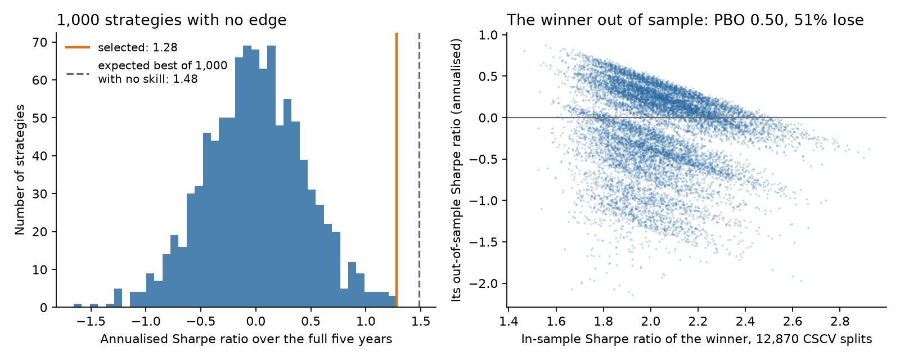

# Procrustes

**Tools that tell you when a backtest was stretched to fit.**

## The result

I generated 1,000 strategies with no edge, five years of daily returns each, and picked the one with the best Sharpe ratio. It showed an annualised Sharpe ratio of 1.28, a t-statistic of 2.86 and a p-value of 0.004. Every tool in this library that knows there were 1,000 trials called it noise: the deflated Sharpe ratio was 0.33, the probability of backtest overfitting was 0.50, the Bonferroni, Holm and BHY adjusted p-values were all 1, and the same selection rule run out of sample by combinatorial purged cross-validation earned a Sharpe ratio of -0.07.



Repeating the experiment on 200 fresh datasets, the uncorrected test called the winner significant every time. The deflated Sharpe ratio never passed 0.95, and Bonferroni passed 2% of the time.

The corrections cost power, and the second column below shows it. I ran the same search again with one strategy that has a true Sharpe ratio of 2. It was selected, and in that draw it still failed every test. Across 200 datasets a true Sharpe ratio of 2 hidden among 999 duds passed the deflated Sharpe ratio 28% of the time and Bonferroni 70% of the time. At a true Sharpe ratio of 3 it passed 96% and 100% of the time.

| | 1,000 strategies, no edge | Same, plus one with a true Sharpe of 2 |
|---|---|---|
| Selected strategy is the real one | no | yes |
| Annualised Sharpe ratio of the selected strategy | 1.28 | 1.65 |
| Its t-statistic | 2.86 | 3.68 |
| p-value as if it were the only test | 0.0042 | 0.00023 |
| Probabilistic Sharpe ratio, benchmark 0 | 0.998 | 1.000 |
| Expected best Sharpe ratio if every trial is skill-less | 1.48 | 1.47 |
| Deflated Sharpe ratio | 0.326 | 0.650 |
| Minimum backtest length for this Sharpe ratio, years | 6.5 | 3.9 |
| Probability of backtest overfitting | 0.502 | 0.466 |
| Bonferroni and Holm adjusted p-value | 1 | 0.233 |
| BHY adjusted p-value | 1 | 1 |
| Mean annualised Sharpe ratio of the 5 CPCV paths | -0.07 | 0.26 |

The full tables are in [`results/headline.md`](results/headline.md) and [`results/monte_carlo.md`](results/monte_carlo.md).

## The question

You tried 200 versions of a strategy and the best one has a Sharpe ratio of 2. How much of that is skill, and how much is the fact that you tried 200?

## Reproduce

```
uv sync
uv run python scripts/reproduce.py
uv run pytest
```

The full run takes about eight minutes and rewrites everything in `results/`. `uv run python scripts/reproduce.py --fast` finishes in a few seconds on a smaller problem and writes to `results_fast/`. Seeds are fixed, so the tables come out identical on every run.

## What was built

- Probabilistic and deflated Sharpe ratio, with the expected maximum Sharpe ratio under N trials, skewness and kurtosis terms, and an option to shrink N when the trials are correlated
- Minimum track record length and minimum backtest length
- Probability of backtest overfitting by combinatorially symmetric cross-validation, with the logit distribution, the performance degradation regression and the out-of-sample probability of loss
- Purged k-fold cross-validation with an embargo
- Combinatorial purged cross-validation, with the backtest paths rebuilt
- Bonferroni, Holm and Benjamini-Hochberg-Yekutieli adjustments on t-statistics

The library depends on numpy and scipy. The splitters work with scikit-learn (`cross_val_score`, `GridSearchCV`) without importing it.

## API reference

Sharpe ratios are per observation unless stated. Kurtosis is the raw fourth moment, 3 for a Normal distribution.

```python
import numpy as np
import procrustes as pc

returns = np.random.default_rng(0).standard_normal((1260, 200)) * 0.01  # T x N trials

pc.deflated_sharpe_ratio_from_returns(returns).dsr  # best column, deflated for 200 trials
pc.cscv(returns, n_blocks=16).pbo  # probability of backtest overfitting
```

### Sharpe ratio inference (`procrustes.sharpe`)

| Function | Returns |
|---|---|
| `sharpe_ratio(returns, axis=0, ddof=1)` | Mean over standard deviation, one value per column |
| `return_moments(returns)` | `(sharpe, skew, kurt, n_obs)` of one series |
| `sharpe_ratio_std(sr, n_obs, skew=0, kurt=3)` | Standard error of an estimated Sharpe ratio |
| `probabilistic_sharpe_ratio(sr, n_obs, sr_benchmark=0, skew=0, kurt=3)` | Probability that the true Sharpe ratio is above the benchmark |
| `min_track_record_length(sr, sr_benchmark=0, skew=0, kurt=3, confidence=0.95)` | Observations needed for the PSR to reach `confidence` |
| `expected_max_standard_normal(n_trials)` | Expected maximum of N standard Normal draws |
| `expected_max_sharpe(n_trials, sr_variance, sr_mean=0)` | Expected best Sharpe ratio among N trials |
| `average_correlation(corr)` | Mean off-diagonal entry of a correlation matrix |
| `effective_number_of_trials(n_trials, avg_correlation)` | `ρ + (1 - ρ)·N` |
| `deflated_sharpe_ratio(sr, n_obs, n_trials, sr_variance, skew=0, kurt=3, avg_correlation=None)` | PSR against the expected best of N skill-less trials |
| `deflated_sharpe_ratio_from_returns(returns, selected=None, adjust_for_correlation=False)` | `DeflatedSharpeResult` for one column of a `T × N` matrix, with every intermediate value |
| `min_backtest_length(n_trials, target_sharpe=1.0)` | Years below which the best of N skill-less trials is expected to reach an annualised `target_sharpe` |
| `min_backtest_length_upper_bound(n_trials, target_sharpe=1.0)` | `2·ln(N) / target²` |

### Probability of backtest overfitting (`procrustes.pbo`)

| Function | Returns |
|---|---|
| `cscv(returns, n_blocks=16, metric=None)` | `PBOResult` with `pbo`, `logits`, `selected`, `is_performance`, `oos_performance`, `degradation_slope`, `degradation_intercept`, `prob_oos_loss` |
| `n_cscv_combinations(n_blocks)` | Number of splits, `C(S, S/2)` |

`metric` is any function from a `rows × N` array to N scores. The default is the Sharpe ratio.

### Cross-validation (`procrustes.cv`)

| Class or function | Purpose |
|---|---|
| `PurgedKFold(n_splits=5, label_start=None, label_end=None, embargo=0)` | K contiguous folds. Training samples whose label interval overlaps the test fold are dropped, and so are the `embargo` samples after it |
| `CombinatorialPurgedKFold(n_groups=6, n_test_groups=2, label_start=None, label_end=None, embargo=0)` | Every combination of k out of N groups as a test set |
| `.split(X, y=None, groups=None)` | Yields `(train, test)` index arrays |
| `.get_n_splits()` | Number of splits |
| `CombinatorialPurgedKFold.n_paths` | `(k/N)·C(N, k)` |
| `CombinatorialPurgedKFold.path_splits()` | Which split feeds each group of each path |
| `CombinatorialPurgedKFold.backtest_paths(predictions, n_samples=None)` | Per-split test forecasts arranged into `n_paths` full-length out-of-sample paths |
| `purged_train_indices(label_start, label_end, test_blocks, embargo=0)` | The purging rule on its own |

`label_start[i]` and `label_end[i]` bound the period that determines sample i's label. They can be numbers or `datetime64`. `embargo` is a number of samples, or a fraction of the sample size if it is a float below 1.

```python
cv = pc.CombinatorialPurgedKFold(6, 2, label_start=t0, label_end=t1, embargo=5)
forecasts = [model.fit(X[train], y[train]).predict(X[test]) for train, test in cv.split(X)]
paths = cv.backtest_paths(forecasts)  # shape (5, n_samples)
```

### Multiple testing (`procrustes.multiple_testing`)

| Function | Returns |
|---|---|
| `p_values_from_t(t_stats, df=None, two_sided=True)` | P-values, Normal by default |
| `bonferroni(p_values)`, `holm(p_values)`, `bhy(p_values, independent=False)` | Adjusted p-values in the input order |
| `adjust_t_statistics(t_stats, method="bhy", alpha=0.05, df=None, two_sided=True)` | `MultipleTestingResult` with `p_values`, `adjusted_p_values`, `reject`, `n_rejected`, `t_hurdle` |

`method` is `"bonferroni"`, `"holm"`, `"bhy"` or `"bh"`.

## Sources

- Bailey and López de Prado, "The Sharpe Ratio Efficient Frontier", Journal of Risk 15(2), 2012
- Bailey and López de Prado, "The Deflated Sharpe Ratio: Correcting for Selection Bias, Backtest Overfitting and Non-Normality", Journal of Portfolio Management 40(5), 2014
- Bailey, Borwein, López de Prado and Zhu, "Pseudo-Mathematics and Financial Charlatanism", Notices of the AMS 61(5), 2014
- Bailey, Borwein, López de Prado and Zhu, "The Probability of Backtest Overfitting", Journal of Computational Finance 20(4), 2017
- Harvey, Liu and Zhu, "... and the Cross-Section of Expected Returns", Review of Financial Studies 29(1), 2016
- López de Prado, Advances in Financial Machine Learning, Wiley, 2018 (purging, embargo, combinatorial purged CV)

I read the first five. The book is not freely available, so the cross-validation code is written from public descriptions of chapters 7 and 12, which `PAPER.md` names. No code was copied from any other implementation.

## Comparison with the sources

`PAPER.md` gives every formula with its equation number and compares 30 worked numbers from the sources with what this library computes. Twenty-seven agree. The three that do not:

- Bailey and López de Prado (2014) report that the expected-maximum approximation is off by about 0.006 at 1,000 trials. Against the exact integral it is off by 0.014. Their figure came from a simulation with enough noise to explain the gap.
- Bailey et al. (2017) print 12,780 splits for 16 blocks. C(16, 8) is 12,870.
- Harvey, Liu and Zhu's Table 4 reports four Holm discoveries. Computed from the table's t-statistics there are six, because the p-value of t = 2.64 is 0.829% and the table prints 0.84%, on the other side of a threshold of 0.833%. With the printed p-values the count is four.

`PAPER.md` also lists the places where a source is silent or inconsistent and the code had to choose: the expected maximum for fewer than two trials, ties and the median rank in PBO, and the last step of the BHY recursion.

## Data

None. Everything runs on simulated returns or on a returns matrix you supply. `scripts/fetch_data.py` exists only to match the layout of the sibling repositories.

## How it is tested

`uv run pytest` runs 221 tests in a few seconds.

- The deflated Sharpe ratio equals the probabilistic one when there is a single trial
- The worked examples in the papers come out to the printed precision: the PSR and track-record examples, the deflated Sharpe example (0.1132 and 0.9004), the minimum backtest length figures, and Harvey, Liu and Zhu's Table 4
- PBO averages 0.5 on pure noise and stays below 0.02 when one strategy has real drift. The tolerances come from a simulation of the estimator's sampling distribution, described in `PAPER.md` section 9
- Under 80 random configurations of label spans, no training label overlaps a test label, the embargo is respected, and no sample is dropped that did not have to be
- The number of combinatorial paths equals (k/N) times C(N, k) for every N up to 10, and the rebuilt paths cover every sample once
- Adjusted p-values agree with the step-down and step-up rejection rules written out directly
- scikit-learn's `cross_val_score` and `GridSearchCV` accept both splitters
- Two runs of the reproduce script write identical tables

CI runs ruff, mypy, the tests and the fast reproduce.

## Layout

```
src/procrustes/      the code
tests/               maths tests first
scripts/reproduce.py   one command rebuilds every figure and table
scripts/fetch_data.py  placeholder; there is no data
results/             committed figures and small tables
PAPER.md             citations, formulas, comparison with the sources, variants tried
```

## Roadmap

- [x] Project skeleton, CI, and the reproduce command
- [x] Probabilistic and deflated Sharpe ratio, with the expected maximum Sharpe under N independent trials
- [x] Minimum backtest length for a given number of trials
- [x] Probability of backtest overfitting by combinatorially symmetric cross-validation
- [x] Purged k-fold cross-validation with an embargo
- [x] Combinatorial purged cross-validation, with the backtest paths rebuilt
- [x] Multiple-testing haircuts: Bonferroni, Holm, and Benjamini-Hochberg-Yekutieli
- [x] `PAPER.md` comparison with the sources
- [x] Results and limits written up at the top of this file

The design called the demonstration a notebook. It is a script, `scripts/reproduce.py`, so that one command rebuilds it and a test can check that it is deterministic.

Not built: the stochastic dominance test from the PBO paper, and the Sharpe ratio haircut of Harvey and Liu (2015), which I have not read.

## Limits

- These tools assume you counted your trials honestly. They cannot find trials you forgot.
- They are conservative. With 1,000 trials and five years of daily data, a strategy with a true Sharpe ratio of 2 passed the deflated Sharpe ratio at 0.95 in 28% of 200 simulated datasets and reached a PBO below 0.05 in 4%. A failed test here is weak evidence against a strategy.
- One PBO number is noisy. On pure noise the estimate averaged 0.50, with a standard deviation of 0.10 across datasets at 1,000 strategies and 16 blocks, and 0.18 at 50 strategies and 10 blocks, where single estimates ranged from 0.06 to 0.96. The thousands of splits reuse the same data and do not average this away.
- BHY with the harmonic constant is harsher than Bonferroni on a lone discovery. In the second column of the table above the Bonferroni p-value is 0.23 and the BHY one is 1.
- Every simulation here uses independent Normal returns and independent strategies. I did not test fat tails, autocorrelation or correlated trials. The correlation adjustment for the deflated Sharpe ratio is implemented as the paper states it and is otherwise unchecked, and the estimate of how correlated the trials were is a judgement.
- The expected-maximum formula overshoots the exact value by 0.036 at 10 trials and 0.014 at 1,000, which makes the deflated Sharpe ratio slightly too strict.
- The purged splitters follow secondary descriptions of the book. Three details I could not check against it are listed in `PAPER.md` section 7.
- Why another one: the best-known library for this is no longer open source, and the other I found is AGPL. This one is MIT and small.
- This is research code. It is not investment advice and it does not trade.

## The name

Procrustes made every guest fit his bed, by stretching them or cutting them down. An overfitted backtest does the same thing to data.

## Licence

MIT. See `LICENSE`.
