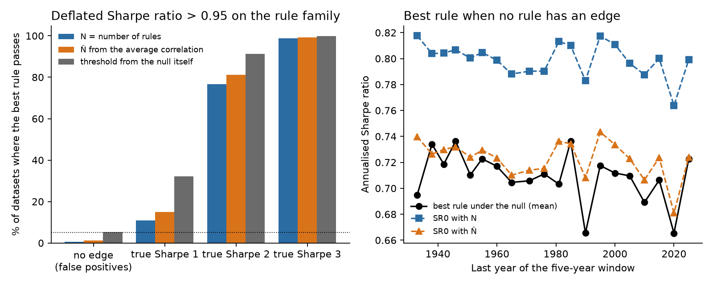

# Procrustes

Tools that check whether a backtest was stretched to fit: the deflated Sharpe ratio, the probability of backtest overfitting, purged cross-validation and multiple-testing adjustments. I test them on simulated strategies and on a real family of 118 correlated trend rules on the US stock market.

## The result

You tried many versions of a strategy and the best one has a good Sharpe ratio. How much of that is skill, and how much is the number of tries?

On the real rule family the deflated Sharpe ratio (DSR) almost never called a skill-less winner real. In 10,000 datasets where no rule had an edge, the best rule passed DSR > 0.95 in 0.7% of them when I counted all 118 rules as trials, and in 1.2% when I used the smaller effective number of trials from the correlation adjustment. The adjustment got the count about right: the rules have an average pairwise correlation near 0.5, the adjustment turns 118 rules into about 60, and the family behaved like 41 to 63 independent trials. The test is still well below a 5% false-positive rate. To pass, the winner has to beat the expected best of the skill-less trials by 1.645 of its own standard errors, and the best of many trials rarely lands that far above its expected value.

That costs power. When I planted a true annualised Sharpe ratio of 1 in one rule, DSR > 0.95 caught it 11% of the time with N = 118 and 15% with the adjusted N. A threshold set from the null distribution itself, which does have a 5% false-positive rate (5.3% measured), caught it 32% of the time. At a true Sharpe ratio of 2 the three rates were 77%, 81% and 91%.



The simulated experiment says the same with independent strategies. I generated 1,000 strategies with no edge, five years of daily returns each, and picked the one with the best Sharpe ratio. It showed an annualised Sharpe ratio of 1.28, a t-statistic of 2.86 and a p-value of 0.004. Every tool that knows there were 1,000 trials called it noise: DSR 0.33, probability of backtest overfitting 0.50, Bonferroni, Holm and BHY adjusted p-values of 1, and an out-of-sample Sharpe ratio of -0.07 for the same selection rule under combinatorial cross-validation. Across 200 fresh datasets DSR never passed 0.95 on pure noise, and it passed 28% of the time when one of the 1,000 strategies had a true Sharpe ratio of 2.

The main limit: these tools only work if you count your trials honestly, and a failed DSR is weak evidence against a strategy. With five years of daily data a true Sharpe ratio of 1 among 118 related rules usually fails it.

## The real rule family

Each rule is long the US market when a fast moving average of the market index is above a slow one, and short when it is below. The fast lengths are 1 (the price itself), 2, 3, 5, 8, 10, 15, 20, 30, 40, 50, 75 and 100 days, the slow lengths 10 to 300 days, and every pair with fast below slow is a rule: 118 rules. The position is set at the close and earns the next day's market excess return. No trading costs are charged. The rules are a test bed for the statistics. I am not proposing them as a strategy.

The data are the daily market excess returns (`Mkt-RF`) from Kenneth French's data library, 1926-07-01 to 2025-12-31. I split 1929 to 2025 into 20 non-overlapping five-year windows, the same length as the simulated experiment.

To get a null in which no rule has an edge but the rules keep their real correlation, I multiplied each day's return by an independent random sign and re-ran every rule on the flipped series. A rule's position uses only past days, and the sign of the next day is independent of the past, so every rule has a true mean of exactly zero. The size of each day's move is kept, so are the fat tails and the volatility clustering. I made 500 such datasets per window. Demeaning the returns would not give a null here. Trend rules earn money from autocorrelation, and demeaning leaves it in place.

For power, I added a constant daily drift to one randomly chosen rule in each null dataset, worth an annualised Sharpe ratio of 1, 2 or 3. The "threshold from the null" column uses the 95% quantile of DSR from half of each window's null datasets and is scored on the other half.

| Planted true Sharpe | Planted rule is the best | DSR > 0.95 with N = 118 | DSR > 0.95 with adjusted N | Threshold from the null |
|---|---|---|---|---|
| none | | 0.7% | 1.2% | 5.3% |
| 1 | 79% | 10.8% | 15.0% | 32.1% |
| 2 | 100% | 76.7% | 81.2% | 91.3% |
| 3 | 100% | 98.8% | 99.2% | 99.8% |

Each row pools 10,000 datasets, so a share near 1% has a standard error of about 0.1 points and a share near 50% about 0.5 points. In no window did the adjusted DSR exceed 2.2% false positives.

On the real, unflipped data the best rule in most windows from 1942 to 1985 was the price against its 10-day average, with annualised Sharpe ratios from 1.4 to 2.9. It passed DSR > 0.95 in 5 of the 20 windows with N = 118 and 6 with the adjusted N, all in windows between 1942 and 1976. No window after 1985 passed. In those six windows the market return's day-to-day autocorrelation was 0.12 to 0.32. In every window since 1995 it was between -0.23 and 0.03. A rule that follows the last few days earns money from that autocorrelation, and these returns are before costs. The tools found a real pattern in the data. That does not make it tradable. Per-window numbers are in [`results/family.md`](results/family.md).

## Cross-validation with overlapping labels

Purging matters when labels overlap in time. I checked how much on the same market data. Each day's label is the next 20 days' summed excess return, so neighbouring labels share 19 days. The features are trailing returns over 5, 20, 60 and 250 days and the trailing 20-day volatility, and the model is a 25-nearest-neighbour regression. I ran it on 1990 to 2025 and on 20 sign-randomised copies, where the label is independent of the features and any skill is leakage.

| Correlation of forecast and 20-day label | Real data | Sign-randomised, mean (standard error) |
|---|---|---|
| Shuffled 5-fold CV | 0.411 | 0.458 (0.006) |
| Combinatorial CV, 6 groups, 2 tested, no purging | 0.049 | -0.008 (0.013) |
| Same, purged and with a 20-day embargo | 0.050 | -0.007 (0.013) |
| No purging minus purged, test days within 20 days of a training group | | 0.015 (0.010) |

Shuffled k-fold leaks badly: a correlation of 0.46 where the truth is zero. Contiguous groups remove almost all of the leak on their own. Only test days at the edge of a group can share a label with a training day, and purging plus the embargo dropped 77 of about 5,865 training days per split. I could not measure a difference from purging on these data. On the edge days it was 0.015 with a standard error of 0.010, and on whole paths it was -0.001. The splitter purges correctly (the tests check it under random label spans); this experiment just shows that with six long contiguous groups the leak it prevents is small. Full table: [`results/leakage.md`](results/leakage.md).

The 0.05 correlation on the real data is the same with and without purging, so it does not come from overlapping labels. I did not test whether it survives costs or other periods.

## The simulated experiment

| | 1,000 strategies, no edge | Same, plus one with a true Sharpe of 2 |
|---|---|---|
| Selected strategy is the real one | no | yes |
| Annualised Sharpe ratio of the selected strategy | 1.28 | 1.65 |
| Its t-statistic | 2.86 | 3.68 |
| p-value as if it were the only test | 0.0042 | 0.00023 |
| Probabilistic Sharpe ratio, benchmark 0 | 0.998 | 1.000 |
| Expected best Sharpe ratio if every trial is skill-less | 1.48 | 1.47 |
| Deflated Sharpe ratio | 0.326 | 0.650 |
| Minimum backtest length for this Sharpe ratio, years | 6.5 | 3.9 |
| Probability of backtest overfitting | 0.502 | 0.466 |
| Bonferroni and Holm adjusted p-value | 1 | 0.233 |
| BHY adjusted p-value | 1 | 1 |
| Mean annualised Sharpe ratio of the 5 combinatorial CV paths | -0.07 | 0.26 |

The returns are independent Normal draws with 1% daily volatility. Each label is one day's return, so no labels overlap and purging removes nothing in the cross-validation row; only the 5-day embargo drops training days.

Over 200 datasets per row:

| True Sharpe of the one real strategy | Winner is the real one | Single test p < 0.05 | DSR > 0.95 | Bonferroni p < 0.05 | BHY p < 0.05 | PBO mean (sd) | PBO < 0.05 |
|---|---|---|---|---|---|---|---|
| 0 | 0% | 100% | 0% | 2% | 0% | 0.50 (0.10) | 0% |
| 1 | 20% | 100% | 0% | 8% | 2% | 0.47 (0.12) | 0% |
| 2 | 89% | 100% | 28% | 70% | 49% | 0.27 (0.14) | 4% |
| 3 | 100% | 100% | 96% | 100% | 100% | 0.04 (0.06) | 71% |

DSR > 0.95 is not a 5%-level test. Under the null it passed in 0 of 200 simulated datasets and 0.7% of the real-family datasets. Read it as a conservative screen. If you need a test with a known false-positive rate, calibrate the threshold on a null like the sign-randomised one above.

The full tables are in [`results/headline.md`](results/headline.md) and [`results/monte_carlo.md`](results/monte_carlo.md).

## Reproduce

```
uv sync
uv run python scripts/fetch_data.py
uv run python scripts/reproduce.py
uv run pytest
```

`fetch_data.py` downloads one free file from Kenneth French's data library (no account or key) into `data/`, which is not committed. The full reproduce run takes about 11 minutes on my machine and rewrites everything in `results/`. `--fast` finishes in seconds on a smaller problem and writes to `results_fast/`. Seeds are fixed, so the tables come out identical on every run with the same download.

The library rebuilds the file monthly and sometimes revises old values. `results/data_fingerprint.csv` holds the date range, the sum and a SHA-256 hash of the series I used. If yours differs, the real-data tables will differ slightly.

## What was built

- Probabilistic and deflated Sharpe ratio, with the expected maximum Sharpe ratio under N trials, skewness and kurtosis terms, and an option to shrink N when the trials are correlated
- Minimum track record length and minimum backtest length
- Probability of backtest overfitting by combinatorially symmetric cross-validation, with the logit distribution, the performance degradation regression and the out-of-sample probability of loss
- Purged k-fold cross-validation with an embargo
- Combinatorial purged cross-validation, with the backtest paths rebuilt
- Bonferroni, Holm and Benjamini-Hochberg-Yekutieli adjustments on t-statistics

The library depends on numpy and scipy. The splitters work with scikit-learn (`cross_val_score`, `GridSearchCV`) without importing it. The experiments in `scripts/` also use scikit-learn and matplotlib.

## API reference

Sharpe ratios are per observation unless stated. Kurtosis is the raw fourth moment, 3 for a Normal distribution.

```python
import numpy as np
import procrustes as pc

returns = np.random.default_rng(0).standard_normal((1260, 200)) * 0.01  # T x N trials

pc.deflated_sharpe_ratio_from_returns(returns).dsr  # best column, deflated for 200 trials
pc.cscv(returns, n_blocks=16).pbo  # probability of backtest overfitting
```

### Sharpe ratio inference (`procrustes.sharpe`)

| Function | Returns |
|---|---|
| `sharpe_ratio(returns, axis=0, ddof=1)` | Mean over standard deviation, one value per column |
| `return_moments(returns)` | `(sharpe, skew, kurt, n_obs)` of one series |
| `sharpe_ratio_std(sr, n_obs, skew=0, kurt=3)` | Standard error of an estimated Sharpe ratio |
| `probabilistic_sharpe_ratio(sr, n_obs, sr_benchmark=0, skew=0, kurt=3)` | Probability that the true Sharpe ratio is above the benchmark |
| `min_track_record_length(sr, sr_benchmark=0, skew=0, kurt=3, confidence=0.95)` | Observations needed for the PSR to reach `confidence` |
| `expected_max_standard_normal(n_trials)` | Expected maximum of N standard Normal draws. Below N = 2 it uses a linear interpolation of my own that is not in the paper (`PAPER.md` section 3) |
| `expected_max_sharpe(n_trials, sr_variance, sr_mean=0)` | Expected best Sharpe ratio among N trials |
| `average_correlation(corr)` | Mean off-diagonal entry of a correlation matrix |
| `effective_number_of_trials(n_trials, avg_correlation)` | `ρ + (1 - ρ)·N` |
| `deflated_sharpe_ratio(sr, n_obs, n_trials, sr_variance, skew=0, kurt=3, avg_correlation=None)` | PSR against the expected best of N skill-less trials |
| `deflated_sharpe_ratio_from_returns(returns, selected=None, adjust_for_correlation=False)` | `DeflatedSharpeResult` for one column of a `T × N` matrix, with every intermediate value |
| `min_backtest_length(n_trials, target_sharpe=1.0)` | Years below which the best of N skill-less trials is expected to reach an annualised `target_sharpe` |
| `min_backtest_length_upper_bound(n_trials, target_sharpe=1.0)` | `2·ln(N) / target²` |

### Probability of backtest overfitting (`procrustes.pbo`)

| Function | Returns |
|---|---|
| `cscv(returns, n_blocks=16, metric=None)` | `PBOResult` with `pbo`, `logits`, `selected`, `is_performance`, `oos_performance`, `degradation_slope`, `degradation_intercept`, `prob_oos_loss` |
| `n_cscv_combinations(n_blocks)` | Number of splits, `C(S, S/2)` |

`metric` is any function from a `rows × N` array to N scores. The default is the Sharpe ratio.

### Cross-validation (`procrustes.cv`)

| Class or function | Purpose |
|---|---|
| `PurgedKFold(n_splits=5, label_start=None, label_end=None, embargo=0)` | K contiguous folds. Training samples whose label interval overlaps the test fold are dropped, and so are the `embargo` samples after it |
| `CombinatorialPurgedKFold(n_groups=6, n_test_groups=2, label_start=None, label_end=None, embargo=0)` | Every combination of k out of N groups as a test set |
| `.split(X, y=None, groups=None)` | Yields `(train, test)` index arrays |
| `.get_n_splits()` | Number of splits |
| `CombinatorialPurgedKFold.n_paths` | `(k/N)·C(N, k)` |
| `CombinatorialPurgedKFold.path_splits()` | Which split feeds each group of each path |
| `CombinatorialPurgedKFold.backtest_paths(predictions, n_samples=None)` | Per-split test forecasts arranged into `n_paths` full-length out-of-sample paths |
| `purged_train_indices(label_start, label_end, test_blocks, embargo=0)` | The purging rule on its own |

`label_start[i]` and `label_end[i]` bound the period that determines sample i's label. They can be numbers or `datetime64`. `embargo` is a number of samples, or a fraction of the sample size if it is a float below 1. Without label spans every label is one sample long and purging removes nothing.

```python
cv = pc.CombinatorialPurgedKFold(6, 2, label_start=t0, label_end=t1, embargo=5)
forecasts = [model.fit(X[train], y[train]).predict(X[test]) for train, test in cv.split(X)]
paths = cv.backtest_paths(forecasts)  # shape (5, n_samples)
```

### Multiple testing (`procrustes.multiple_testing`)

| Function | Returns |
|---|---|
| `p_values_from_t(t_stats, df=None, two_sided=True)` | P-values, Normal by default |
| `bonferroni(p_values)`, `holm(p_values)`, `bhy(p_values, independent=False)` | Adjusted p-values in the input order |
| `adjust_t_statistics(t_stats, method="bhy", alpha=0.05, df=None, two_sided=True)` | `MultipleTestingResult` with `p_values`, `adjusted_p_values`, `reject`, `n_rejected`, `t_hurdle` |

`method` is `"bonferroni"`, `"holm"`, `"bhy"` or `"bh"`.

## Sources

- Bailey and López de Prado, "The Sharpe Ratio Efficient Frontier", Journal of Risk 15(2), 2012
- Bailey and López de Prado, "The Deflated Sharpe Ratio: Correcting for Selection Bias, Backtest Overfitting and Non-Normality", Journal of Portfolio Management 40(5), 2014
- Bailey, Borwein, López de Prado and Zhu, "Pseudo-Mathematics and Financial Charlatanism", Notices of the AMS 61(5), 2014
- Bailey, Borwein, López de Prado and Zhu, "The Probability of Backtest Overfitting", Journal of Computational Finance 20(4), 2017
- Harvey, Liu and Zhu, "... and the Cross-Section of Expected Returns", Review of Financial Studies 29(1), 2016
- López de Prado, Advances in Financial Machine Learning, Wiley, 2018 (purging, embargo, combinatorial purged CV)
- Kenneth R. French, Data Library, "Fama/French 3 Factors [Daily]", for the market excess return

The formulas and worked examples come from the first five papers. `PAPER.md` gives the equation numbers and the copies used. I have not read the book; the cross-validation code is my implementation of the published idea. No code was copied from any other implementation.

## Comparison with the sources

`PAPER.md` gives every formula with its equation number and compares 28 worked numbers from the papers with what this library computes. Twenty-five agree. The three that do not:

- Bailey and López de Prado (2014) report that the expected-maximum approximation is off by about 0.006 at 1,000 trials. Against the exact integral it is off by 0.014. Their figure came from a simulation with enough noise to explain the gap.
- Bailey et al. (2017) print 12,780 splits for 16 blocks. C(16, 8) is 12,870.
- Harvey, Liu and Zhu's Table 4 reports four Holm discoveries. Computed from the table's t-statistics there are six, because the p-value of t = 2.64 is 0.829% and the table prints 0.84%, on the other side of a threshold of 0.833%. With the printed p-values the count is four.

`PAPER.md` also lists the places where a source is silent or inconsistent and the code had to choose: the expected maximum for fewer than two trials, ties and the median rank in PBO, and the last step of the BHY recursion.

## How it is tested

`uv run pytest` runs 232 tests in under a minute.

- The deflated Sharpe ratio equals the probabilistic one when there is a single trial
- The worked examples in the papers come out to the printed precision: the PSR and track-record examples, the deflated Sharpe example (0.1132 and 0.9004), the minimum backtest length figures, and Harvey, Liu and Zhu's Table 4
- PBO averages 0.5 on pure noise. It stays below 0.02 when one strategy has a per-observation Sharpe ratio of 0.3, which is about 4.8 annualised at 252 observations a year: a very large edge. The tolerances come from a simulation of the estimator's sampling distribution, described in `PAPER.md` section 9
- Under 80 random configurations of label spans, no training label overlaps a test label, the embargo is respected, and no sample is dropped that did not have to be
- The number of combinatorial paths equals (k/N) times C(N, k) for every N up to 10, and the rebuilt paths cover every sample once
- Adjusted p-values agree with the step-down and step-up rejection rules written out directly
- scikit-learn's `cross_val_score` and `GridSearchCV` accept both splitters
- The trend rules use no future data, the sign-randomised null removes a planted trend edge, and the family's DSR matches the library function
- Two runs of the reproduce script write identical tables

CI runs ruff, mypy, the data download, the tests and the fast reproduce.

## Layout

```
src/procrustes/          the library
tests/                   maths tests and experiment tests
scripts/reproduce.py     one command rebuilds every figure and table
scripts/fetch_data.py    downloads the market series into data/
scripts/trend_family.py  the moving-average rule family and its null
scripts/leakage.py       the overlapping-label cross-validation experiment
results/                 committed figures and small tables
PAPER.md                 citations, formulas, comparison with the sources, variants tried
```

## Limits

- These tools assume you counted your trials honestly. They cannot find trials you forgot.
- DSR > 0.95 is conservative. Its false-positive rate was 0% on simulated noise and 0.7% to 1.2% on the real rule family. Its power at a true Sharpe ratio of 1 over five years was 11% to 15% on the family and 0% among 1,000 independent strategies.
- One PBO number is noisy. On pure noise the estimate averaged 0.50, with a standard deviation of 0.10 across datasets at 1,000 strategies and 16 blocks, and 0.18 at 50 strategies and 10 blocks, where single estimates ranged from 0.06 to 0.96.
- BHY with the harmonic constant is harsher than Bonferroni on a lone discovery. In the simulated table the Bonferroni p-value is 0.23 and the BHY one is 1.
- The correlation adjustment is checked on one family only: 118 moving-average rules with an average correlation near 0.5. A family with a few tight clusters could behave differently from what one average correlation says.
- The sign-randomised null keeps the size of each day's move but destroys any link between a day's sign and the past. It is the right null for timing rules. It would not be for strategies whose edge is the mean itself.
- The real-data rules are charged no costs. The rule that passed in 1942 to 1976 trades often, and its result is not a claim that it was tradable.
- The expected-maximum formula overshoots the exact value by 0.036 at 10 trials and 0.014 at 1,000, which makes the deflated Sharpe ratio slightly too strict.
- This is research code. It is not investment advice and it does not trade.

The name: Procrustes stretched or cut his guests to fit his bed, which is what an overfitted backtest does to data.

## Licence

MIT. See `LICENSE`.
